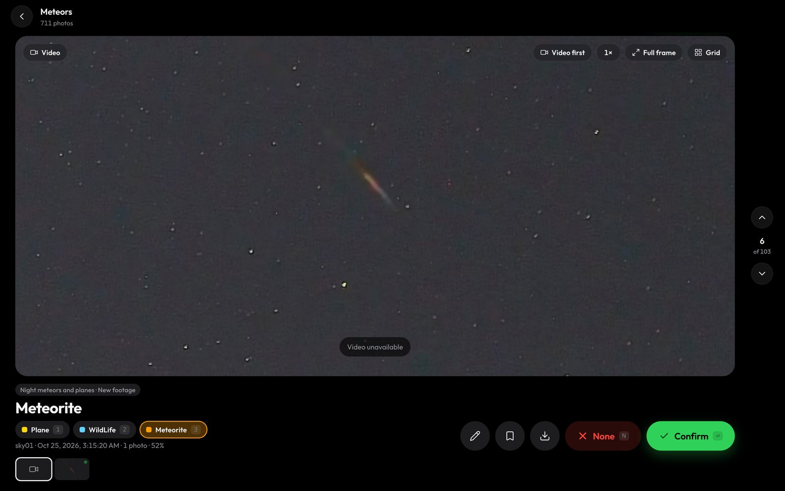
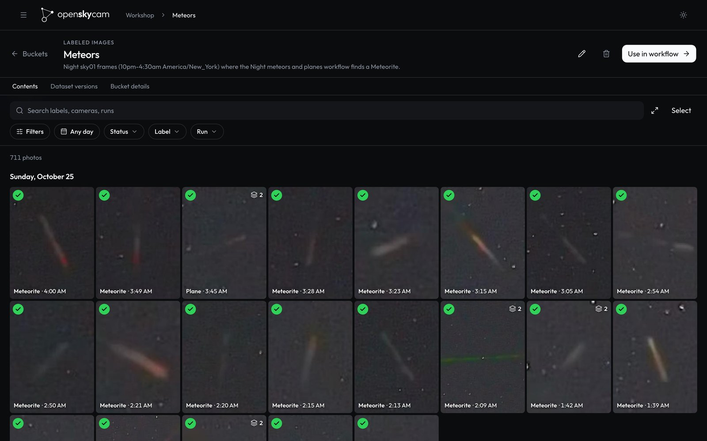
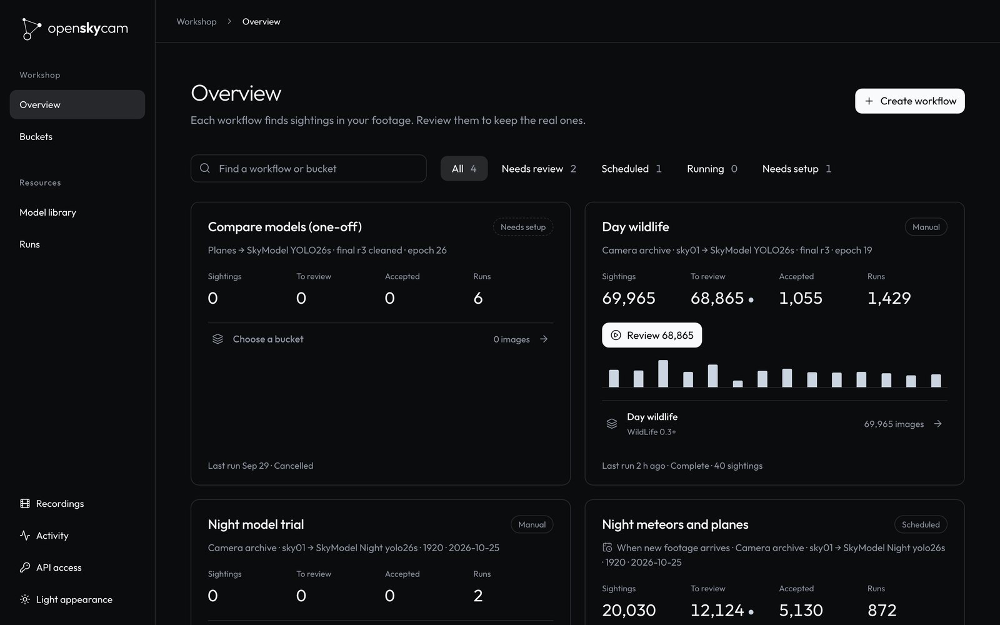
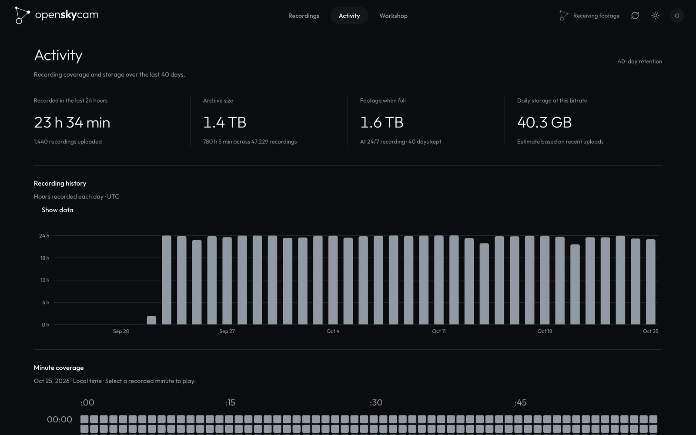

<p align="center">
  <picture>
    <source media="(prefers-color-scheme: dark)" srcset="package/dashboard/openskycam-media-kit/logo/svg/openskycam-horizontal-white.svg">
    
  </picture>
</p>

<p align="center">
  Record the sky around the clock, keep the footage on your own disk, and find what flew past.
</p>

<p align="center">
  <a href="https://docs.openskycam.org/">Documentation</a> ·
  <a href="https://docs.openskycam.org/deploy/">Deploy your own</a> ·
  <a href="https://docs.openskycam.org/agents/">Run it with an agent</a> ·
  <a href="https://docs.openskycam.org/api/">API</a>
</p>

<p align="center">
  <a href="https://github.com/Deibler/openskycam/actions/workflows/check.yml"></a>
  <a href="LICENSE"></a>
</p>



<p align="center"><sub>A meteor at 07:15 UTC on 25 October 2026, found by a nightly workflow and waiting in the review view.</sub></p>

openskycam records an IP camera pointed at the sky, 24 hours a day. A relay copies the camera's stream into one-minute MP4 files without re-encoding, and the files live on a disk you own. Cloudflare Workers catalog every minute and serve a website and an API. A processor on your own machine runs detection models over the footage.

- **Browse and download footage.** Pick a day, scrub through the hours and download the original file. Footage is kept for 40 days by default.
- **Find things in it.** Build a workflow that samples frames from a time window, runs detection models, and routes each frame to a bucket by class, score, count, time or motion. Run it once, or every night as footage arrives.
- **Tell planes from stars.** Boxes from the same object are linked across a recording into a track that is moving, stationary or brief. A workflow can keep moving aircraft and set fixed lights aside.
- **Build training data.** Review detections, correct boxes, and freeze a dataset version with its images, labels, tracks and splits.
- **Hand it to your agent.** An AI agent can set it up, run it and change its code: every website action is a `/v1` API call, an MCP server gives agents seven tools that cover the website, and the setup runs unattended from `.env`.

## A look inside

<table>
  <tr>
    <td width="50%"><br><sub><b>Buckets.</b> One night's meteors, sorted into a bucket and reviewed.</sub></td>
    <td width="50%"><br><sub><b>Workshop.</b> Workflows with their sightings, reviews and runs.</sub></td>
  </tr>
  <tr>
    <td colspan="2"><br><sub><b>Workflows.</b> The night workflow: one detection model, then conditions that send meteors, moving planes and fixed lights to separate buckets.</sub></td>
  </tr>
  <tr>
    <td colspan="2"><br><sub><b>Activity.</b> Recording coverage and storage over the 40-day window.</sub></td>
  </tr>
</table>

## How it works

```
IP camera ──RTSP──▶ relay ──HTTPS PUT──▶ ingest Worker ──Tunnel──▶ footage store
 H.264 or H.265     Linux host,          validates, names,           your disk, rolling
                    60 s MP4s, no        catalogs in D1              40-day window
                    re-encoding

website + API Worker ◀── Cloudflare Access (you), API keys (scripts, agents)
        │
        └── jobs over HTTPS ──▶ processor: decodes frames, runs YOLO models, tracks motion
                                (macOS with an Apple GPU, Linux with an NVIDIA GPU, or CPU)
```

| Part | Runs on | Code |
|---|---|---|
| Relay | A Linux host near the camera; a Raspberry Pi 4 or 5 is enough | [`external/relay`](external/relay) |
| Ingest Worker | Cloudflare Workers | [`package/worker`](package/worker) |
| Footage store | A macOS or Linux host with a large disk, about 43 GB a day at 4 Mbps | [`external/store`](external/store) |
| Website and API | Cloudflare Workers, D1, R2 and Durable Objects, behind Cloudflare Access | [`package/dashboard`](package/dashboard) |
| Processor | A macOS or Linux host; a GPU is optional | [`processor`](processor) |
| Documentation | Static files on a Worker | [`package/docs`](package/docs) |

Footage never leaves your disk. The Workers reach the store through a Cloudflare Tunnel, so one camera stays inside or near Cloudflare's free tiers. [How it works](https://docs.openskycam.org/how-it-works/) follows a recording and a workflow run from end to end, including what happens when a part is down.

## Get started

You need an RTSP camera, a Linux machine near it for the relay (a Raspberry Pi is enough), a machine with a large disk, and a Cloudflare account with a domain. Then run:

```sh
curl -fsSL https://raw.githubusercontent.com/Deibler/openskycam/main/setup/install.sh | bash
```

It checks your tools, downloads openskycam to `~/openskycam` and starts a guided setup. The setup signs in to Cloudflare, creates the database and buckets, installs the footage store and the relay over SSH, deploys both Workers, and waits for the first recording to arrive. For the two things only the Cloudflare dashboard can do, a tunnel and the sign-in application, it explains each click and checks what you paste. Answers are saved in `.env`, so you can stop and run `npm run setup` again; `npm run setup -- --check` checks a running deployment and changes nothing.

[Deploy your own](https://docs.openskycam.org/deploy/) explains every step the setup runs, if you would rather do it by hand. To work on the code:

```sh
git clone https://github.com/Deibler/openskycam.git && cd openskycam
npm install
make check               # every test suite, the docs build and shell lint; needs no Cloudflare account
```

## Run it with your agent

openskycam is built for an AI agent to operate:

- **It covers the whole website.** Connected to the MCP server at `/v1/mcp`, an agent can browse and download footage, take a photo from stored video at any second, build and test workflows, schedule them, follow runs live, review detections, freeze datasets, check the processor and assign models to devices.
- **The server teaches it.** On connect, the agent gets instructions plus six guides and five step-by-step skills (`build-a-workflow`, `find-detections`, `take-photos`, `download-footage`, `verify-changes`).
- **It runs the setup.** `npm run setup -- --yes` asks nothing: it reads every answer from `.env`, stops naming the key it needs, and skips finished steps when run again. `npm run setup -- --check` checks all nine steps of a running deployment and exits with 1 when one fails.
- **It can change the code safely.** [`AGENTS.md`](AGENTS.md) gives the conventions, and `make check` runs every test and the architecture checks without a Cloudflare account.
- **The server enforces the guardrails.**
  - No key can create keys.
  - Deletes show a preview and need a confirmation.
  - Edits fail rather than overwrite a newer revision.
  - Every tool call is logged.

You ask in plain words: *"Did the camera record all night?"*, *"Find last night's meteors and show me the clearest three"*, *"Build a workflow that keeps moving planes between 02:00 and 09:30 UTC and run it every night"*, *"Review the waiting images in Planes"*. Three steps need a person:
- the first Cloudflare login;
- creating the tunnel and the sign-in application in the Cloudflare dashboard;
- creating API keys on the website.

[Run it with an agent](https://docs.openskycam.org/agents/) maps each request to the tool that answers it.

Create an **Agent** key under **API access** on your website, then connect, for example with Claude Code:

```sh
claude mcp add --transport http openskycam https://<api-host>/v1/mcp --header "Authorization: Bearer $OPENSKYCAM_KEY"
```

## Use the API

Create a key on the website under **API access**. An Agent key that covers every camera can call everything the website does:

```sh
curl -H "Authorization: Bearer $OPENSKYCAM_KEY" https://<api-host>/v1/workshop
curl -H "Authorization: Bearer $OPENSKYCAM_KEY" "https://<api-host>/v1/recordings?camera=sky01&from=2026-10-25T02:00:00Z&to=2026-10-25T03:00:00Z"
```

`/openapi.json` describes the API for client generation.

## Models

[`models/night-detector`](models/night-detector) is a trained YOLO26s detector for planes and meteors at night, ready to publish to your registry and use in a workflow. On held-out nights it found 95% of planes and 90% of meteors, and flagged 7% of stars and fixed lights; its card explains how that was measured. To train your own on frames you have reviewed, open [`processor/examples/train_detector.ipynb`](processor/examples/train_detector.ipynb) in Colab.

## Repository

```text
package/
  dashboard/     React website, footage API, Workshop, models, MCP server (Cloudflare Worker)
  worker/        Recording ingest API (Cloudflare Worker)
  shared/        Cross-Worker code, architecture checks, deploy config
  docs/          Builds the documentation site from docs/
external/
  relay/         Recorder and uploader for the relay host
  store/         Footage store and tunnel for the storage host
processor/       Python processor: Workshop runs, model sync, tracking, a training notebook
db/migrations/   Catalog, inference, model and Workshop schema
docs/            The documentation (docs.openskycam.org)
models/          Trained models to publish to your registry, starting with a night detector
setup/           The installer and guided setup
camera_mcp.py    Camera settings for Dahua cameras, as an MCP server
```

Packages and cloud resources keep the project's first name, SkyVision (`skyvision-dashboard`, `skyvision_processor`, the `skyvision-catalog` database).

## Contributing

Bug reports, fixes and support for more cameras and hardware are welcome. Read [CONTRIBUTING.md](CONTRIBUTING.md) and the [architecture guide](https://docs.openskycam.org/develop/architecture/), and run `make check` before opening a pull request. Report security issues privately as described in [SECURITY.md](SECURITY.md).

## License

[MIT](LICENSE), except the model weights in [`models/`](models), which carry their own license (AGPL-3.0 for the night detector, as a derivative of Ultralytics YOLO). The openskycam name and logo in [`package/dashboard/openskycam-media-kit`](package/dashboard/openskycam-media-kit) identify the original project and are not covered by the license.
