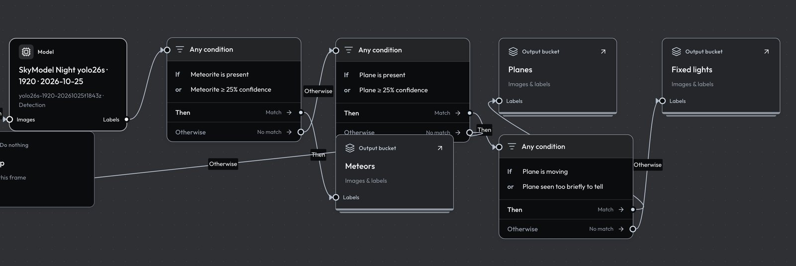

A workflow is a graph of steps that reads video or labeled images, runs detection models on sampled frames, and sends each frame down a path to a labeled bucket (or nowhere). Workflows and buckets live in one **Workshop document**, saved in D1 with a revision number. You edit it in the website's Workshop editor or through the API (`GET` and `PUT /v1/workshop`, see [Workshop API](../api/workshop.md)). The [processor](../processor.md) executes the steps, so the rules on this page are enforced twice: by the server when you save or run, and by the processor that follows the graph.



## The Workshop document

```json
{
  "revision": 746,
  "document": {
    "version": 3,
    "buckets": [{ "id": "camera-archive", "kind": "raw", "name": "Camera archive", "description": "…", "createdAt": null }],
    "workflows": [{ "id": "night", "name": "Night sky", "updatedAt": "…", "nodes": [], "edges": [] }]
  }
}
```

- **Revisions.** `PUT` sends the whole document with the `revision` you read. If anyone saved since, the save fails with `409` and nothing changes; read again and reapply your edit. A successful save returns `revision + 1`.
- **Buckets.** Exactly one raw bucket exists, `camera-archive` (your cameras' recordings, `createdAt: null`). Every other bucket is `labeled` and needs an ISO `createdAt`. Names are unique ignoring case. A save cannot remove a bucket or change its kind; delete it with the bucket deletion action instead (see [Buckets and datasets](datasets.md)).
- **Workflows.** A save cannot drop a workflow either. Deleting one goes through `DELETE /api/workshop/workflows/{id}` with `{"revision": n}`, which also cancels its queued and leased jobs; `GET /api/workshop/workflows/{id}/deletion` previews what it affects. Output buckets and finished results stay.

| Limit | Value |
| --- | --- |
| Buckets per document | 500 |
| Workflows per document | 100 |
| Steps (nodes) per workflow | 100 |
| Connections (edges) per workflow | 300 |
| Saved document size | 750,000 bytes of JSON |
| Bucket and workflow IDs | `^[a-zA-Z0-9][a-zA-Z0-9_-]{0,79}$` |
| Bucket name / description | 100 / 300 characters |

### Steps and connections

Each node is `{"id", "type": "workshop", "position": {"x", "y"}, "data": {...}}`, and `data.kind` names the step. `data.label` is the text shown on the canvas. An edge connects a source port to the target's `in` port: `{"id", "source", "target", "sourceHandle": "out" | "yes" | "no", "targetHandle": "in"}`. Conditions have `yes` and `no` ports; every other step with an output has `out`.

## Steps

### Input

Where the run's media comes from. `bucketId` is `camera-archive` for recorded video, or a labeled bucket's ID to reprocess images other runs saved.

| Setting | Meaning |
| --- | --- |
| `bucketId` | `camera-archive`, or a labeled bucket. `""` while unset; a run refuses it. |
| `camera` | Camera ID for `camera-archive`, for example `sky01`. Must be one of the deployment's `CAMERAS`. |
| `includeRejected` | Labeled input only. `true` also takes images a reviewer rejected. Default `false`. |

A labeled input is pinned when the run starts: its current images and labels at that moment, one job per image. A full run refuses a bucket with more than 2,000 eligible images; a test takes the newest captures up to its image count. Later additions and edits do not reach a running job.

### Frame sampling (footage)

Required after a `camera-archive` input, and not allowed after a labeled one (those are already images). It selects one recorded window per run and keeps one frame per interval.

| Setting | Meaning |
| --- | --- |
| `day` | Recorded UTC date, `YYYY-MM-DD`, or `run-day` (the day each run is created) or `previous-day` (the day before). |
| `from`, `until` | UTC time of day, `HH:MM` or `HH:MM:SS`. `from` must be before `until`; a window cannot cross midnight. |
| `interval` | Seconds between samples, 1–3,600. |
| `pick` | `first` (default) or `change`. Shown as **Frame kept**: First frame or Most change. |

Every recording that overlaps the window and is still inside the 40-day retention becomes one job. A job gets one **slot** per whole interval of its overlap with the window: a recording that covers 60 s of the window at a 1 s interval has 60 slots. A partial last slot is dropped, because a clip can end before its last frame would start.

- **`first`** keeps the first frame at or after each slot's tick. If a keyframe follows the tick within `min(1.5 s, interval)` and inside the slot, the processor decodes that one frame; otherwise it decodes up to the exact tick. This is the fastest choice.
- **`change`** decodes every frame and keeps, for each slot, the frame with the most **new light**: on a quarter-size grey copy of the frame, the brightest pixel (after a 3×3 blur) that none of the previous 8 frames (about 1 s at 8 fps) was as bright at. Stars and slow planes are in the previous frames, so they cancel; a meteor or a strobe flash stands out. Light that keeps recurring at the same pixels, such as the camera's burned-in clock, is masked out. Decoding starts 1 s before the window so the first frames have history. A `change` run also follows each saved moving or brief object through every frame. The constants and the reason are in [Tracking and trajectories](tracking.md).

A slot the recorder skipped entirely (the next frame lies past the slot) is reported empty instead of reusing a later frame. A recording that ends before its last slot fails its job.

### Model

Runs one published model on every frame that reaches it.

| Setting | Meaning |
| --- | --- |
| `modelKey` | `family/version` of a published model, for example `night-detector/v1`. |
| `score` | Confidence threshold, 0–1. Detections below it are discarded; a classifier's top class is kept only at or above it. |

The input size is not a setting: it comes from the model's manifest (`input.width`, `input.imgsz` or `input.training_size`), rounded up to a multiple of 32, 640 when none is given. The saved frame stays full size; the processor shrinks a copy to fit the model and stores boxes as fractions of the full frame, `[left, top, right, bottom]`.

A workflow uses one to four models. A model is accepted when its adapter is `ultralytics`, its task is `object-detection` or `image-classification`, it has a class list, and it has a `.pt` artifact. Models whose name says tiled or crop, or whose input is a crop, are refused because they need preprocessing this runner does not have. See [Models](../models.md) for publishing.

A later model **replaces** the predictions of an earlier one; it does not add to them. Conditions always read the predictions of the most recent model on the frame's path, and a later model only runs on frames that reached it.

### Condition

Sends each frame to its `yes` port (shown as Then) or its `no` port (Otherwise).

| Setting | Meaning |
| --- | --- |
| `match` | `all`: every rule must match. `any`: at least one must. |
| `rules` | 1–8 rules, each with a unique `id` and a `kind`. |

| Rule `kind` | Fields | Matches when |
| --- | --- | --- |
| `class` | `className`, `operator`: `present` or `absent` | At least one prediction of the class exists (`present`), or none does (`absent`). |
| `confidence` | `className`, `operator`: `at-least` or `below`, `threshold` 0–1 | At least one prediction of the class scores at or above the threshold (`at-least`), or at least one scores below it (`below`). |
| `count` | `className`, `operator`: `at-least`, `equal` or `at-most`, `count` 0–10,000 | The number of predictions of the class in the frame compares that way. |
| `motion` | `className`, `operator`: `moving`, `stationary` or `brief` | At least one box of the class has that motion across its recording. |
| `time` | `from`, `until` (`HH:MM[:SS]`), `timeZone` (IANA) | The frame's capture time, in that zone, is at or after `from` and before `until`. `from > until` is an overnight range; `from = until` is refused. |
| `weekday` | `days` (0 = Sunday … 6 = Saturday), `timeZone` | The capture day, in that zone, is one of `days`. |

An empty `className` means any class, and class names compare ignoring case. Rules in one condition are checked independently: in an `all` group, a `class` rule and a `confidence` rule can be satisfied by different boxes. Put the class on the `confidence` or `count` rule itself when both must hold for the same object.

Capture time is the recording's start plus the frame's offset, in UTC, or the original capture time of a labeled-bucket image.

**Motion** reads each box's track. A track's motion is decided once per recording, from every detection the model made of that object, before any condition reads it. A box with no track, which is any box in a labeled-bucket input and any classifier label, counts as `brief`. A motion rule therefore only distinguishes objects in video runs.

The rule is "any box of the class has that motion", so a frame holding a moving plane and a fixed light matches both `moving` and `stationary`. To set fixed lights aside, never route on `stationary` directly. Match `any` of `moving` and `brief` for the class, send `yes` to the bucket you keep, and send `no`, which then holds only frames whose every box of the class is stationary, to another bucket.

### Output and Do nothing

| Kind | Setting | Meaning |
| --- | --- | --- |
| `output` | `bucketId`: a labeled bucket | Saves the frame, its labels and provenance in that bucket. |
| `nothing` | none | Ends the path. The frame is checked and discarded. |

An output can receive several connections, so both branches of a condition may end in the same bucket. A run cannot write into its own input bucket, and `camera-archive` is never an output.

### Schedule

Starts the workflow automatically. One per workflow, connected only to the input step.

| Setting | Meaning |
| --- | --- |
| `trigger` | `time` (At a set time), `arrival` (When new footage arrives) or `workflow` (After another workflow). |
| `days`, `at` | `time` only: weekdays (0 = Sunday … 6 = Saturday) and a UTC time `HH:MM`. |
| `workflowId` | `workflow` only: the workflow this one follows. |
| `onlyIf` | Skip the run when there is nothing to process (details below). |

How each trigger behaves:

- **At a set time** starts once per chosen day at `at` UTC. If the scheduler misses that minute, the slot still starts any time in the next hour. The run processes the footage window in full.
- **When new footage arrives** is checked every 15 minutes and takes only recordings uploaded since the last scheduled run (the first takes everything already in the window), inside the footage window. With nothing new, it records `skipped`.
- **After another workflow** starts when a full (not test) run of the named workflow finishes with at least one completed job. A newly added follow schedule ignores upstream runs older than an hour. Workflows cannot follow each other in a loop; the save is refused.
- A labeled-bucket input always takes only images added since the last scheduled run, whatever the trigger.
- **`onlyIf`** skips a set-time run when its window has no footage, and a follow run when the upstream run saved no images.

A scheduled workflow's footage `day` must be `run-day` or `previous-day`; a fixed date would process the same footage every time and is refused. With `run-day`, `at` must be at least 10 minutes after the window's `until` so its last clips have uploaded. A window that would need a time after midnight must use `previous-day`. A slot that starts late, after midnight, still takes the day of its slot. When new footage arrives needs `run-day` and a window that ends by 23:35 UTC, so its last clips upload before the day's final check at 23:45.

The dashboard Worker's cron runs every minute. A scheduled run's ID is `sched_` plus a hash of the workflow and trigger, so a repeated or retried minute never starts a second run. Scheduled runs go to the newest [processor runtime](runs.md) that has checked in; with none, the outcome is `failed` and the next minute tries again. `GET /api/workshop/schedules` lists each schedule's last outcome: `started` (with `run_id`), `skipped`, or `failed` (with `message`). The editor shows the same.

## Rules before a run

Drafts can be incomplete, but **Check workflow** and every run validate the graph on the server and name the first problem:

- Exactly one input and at least one output, with every bucket chosen, and no output writing into the input bucket.
- A `camera-archive` input has exactly one frame sampling step; a labeled input has none.
- Frame sampling comes before any model; `class`, `confidence`, `count` and `motion` rules have a model upstream; every path to an output passes a model.
- Each processing step has exactly one incoming connection, and every output port is connected: `yes` and `no` on a condition, `out` elsewhere. Outputs and Do nothing may receive several.
- No cycles, no unconnected steps, at most one schedule.
- One to four models, each available with its weights.
- A workflow that keeps frames by `change` or has a `motion` rule needs a processor runtime with the `tracking` capability.

## Example: a night workflow that sets fixed lights aside

This workflow processes each night's footage from 02:00 to 09:30 UTC as it arrives. It keeps the frame with the most new light in each second and runs a night detector at 0.3. Frames with a moving or briefly seen Plane go to **Planes**. Frames whose planes all stay still, which are stars and fixed lights the model mistook for planes, go to **Fixed lights**. Add these buckets and the workflow to the document and save it with the revision you read.

```json
{
  "buckets": [
    { "id": "planes", "kind": "labeled", "name": "Planes", "description": "Moving or brief Plane detections", "createdAt": "2026-10-25T00:00:00.000Z" },
    { "id": "fixed-lights", "kind": "labeled", "name": "Fixed lights", "description": "Plane detections that never moved", "createdAt": "2026-10-25T00:00:00.000Z" }
  ],
  "workflow": {
    "id": "night",
    "name": "Night sky",
    "updatedAt": "2026-10-25T00:00:00.000Z",
    "nodes": [
      { "id": "arrival", "type": "workshop", "position": { "x": 0, "y": 0 },
        "data": { "kind": "schedule", "label": "New footage", "trigger": "arrival", "days": [], "at": "", "workflowId": "", "onlyIf": false } },
      { "id": "input", "type": "workshop", "position": { "x": 300, "y": 0 },
        "data": { "kind": "input", "label": "Camera archive", "bucketId": "camera-archive", "camera": "sky01" } },
      { "id": "frames", "type": "workshop", "position": { "x": 600, "y": 0 },
        "data": { "kind": "footage", "label": "Night, most change", "day": "run-day", "from": "02:00", "until": "09:30", "interval": 1, "pick": "change" } },
      { "id": "detect", "type": "workshop", "position": { "x": 900, "y": 0 },
        "data": { "kind": "model", "label": "Night detector", "modelKey": "night-detector/v1", "score": 0.3 } },
      { "id": "moving", "type": "workshop", "position": { "x": 1200, "y": 0 },
        "data": { "kind": "condition", "label": "Plane moving or brief", "match": "any", "rules": [
          { "id": "moving", "kind": "motion", "className": "Plane", "operator": "moving" },
          { "id": "brief", "kind": "motion", "className": "Plane", "operator": "brief" }
        ] } },
      { "id": "keep", "type": "workshop", "position": { "x": 1500, "y": -100 },
        "data": { "kind": "output", "label": "Planes", "bucketId": "planes" } },
      { "id": "aside", "type": "workshop", "position": { "x": 1500, "y": 100 },
        "data": { "kind": "output", "label": "Fixed lights", "bucketId": "fixed-lights" } }
    ],
    "edges": [
      { "id": "e1", "source": "arrival", "target": "input", "sourceHandle": "out", "targetHandle": "in" },
      { "id": "e2", "source": "input", "target": "frames", "sourceHandle": "out", "targetHandle": "in" },
      { "id": "e3", "source": "frames", "target": "detect", "sourceHandle": "out", "targetHandle": "in" },
      { "id": "e4", "source": "detect", "target": "moving", "sourceHandle": "out", "targetHandle": "in" },
      { "id": "e5", "source": "moving", "target": "keep", "sourceHandle": "yes", "targetHandle": "in" },
      { "id": "e6", "source": "moving", "target": "aside", "sourceHandle": "no", "targetHandle": "in" }
    ]
  }
}
```

Why it is built this way:

- **The trigger is When new footage arrives.** A full run takes at most 100 recordings and 2,000 sampled frames. The whole 7.5-hour window has 450 one-minute recordings and 27,000 one-second slots, so a set-time run of it would be refused. Every 15 minutes the arrival trigger takes only the recordings uploaded since the last run, about 15 recordings and 900 frames, and outside 02:00–09:30 it finds nothing and records `skipped`.
- **The first arrival run has no earlier run to count from**, so it takes everything already uploaded in the window. Add the schedule outside 02:00–09:30. Added mid-window, the first run can exceed 100 recordings and fail each time until the window starts empty the next night.
- **`run-day`** is required for When new footage arrives, and here it means "tonight": the window is the UTC date each run is created on.
- **Frames with no Plane at all** take the `no` branch too, since neither rule matches. Put a condition with a `class` rule (`Plane`, `present`) in front of this one if those frames should go elsewhere, or to Do nothing.
- Run a [test](runs.md) of 20–100 frames first; it uses the same pinned models and sampling and saves nothing.
